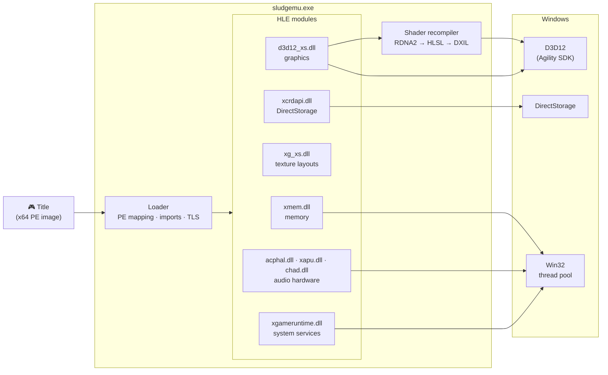

<div align="center">


### Run Xbox Series X|S titles natively on Windows desktop

No CPU emulation. sludgemu loads the console's x64 code directly and rebuilds the console platform around it.

<br>


**[How it works](#-how-it-works)** ·
**[Status](#-status)** ·
**[Building](#-building)** ·
**[Running](#-running)** ·
**[Diagnostics](#-diagnostics)** ·
**[Deep dive](#-deep-dive)** ·
**[Contributing](#-contributing)**

</div>

---

> [!WARNING]
> **sludgemu is in early development.** The loader, memory model, graphics translation, shader
> recompiler, DirectStorage and audio paths all exist and are under active work, but many console
> APIs are still logging stubs and there is no compatibility list. Expect titles to stop at startup, hang or crash, and don't expect any title to
> be playable yet.

> [!IMPORTANT]
> sludgemu contains **no Microsoft GDK code or headers** and **no title code or data**. To use it you
> need your own legally obtained, decrypted title package. Issues or PRs that contain GDK material,
> title files or links to them will be closed.

## 🧠 How it works

An Xbox Series X|S ("Scarlett") title is an **x64 Windows PE image** built against the console
flavour of the Microsoft GDK. The CPU is a Zen 2, and the code is ordinary MSVC-compiled x64. The
console differs from a PC in the platform *around* that code: its memory model, its GPU and driver
stack, its storage and audio hardware, and its system services.

So sludgemu is not a traditional emulator. It **maps the title straight into its own process**, runs
its code at full native speed, and supplies every console-only DLL the title imports with its own
implementation, called an **HLE module**:



| Console piece | What sludgemu does |
|---|---|
| **CPU** (Zen 2) | Runs title code natively. A few AMD-only instructions (`CLZERO`, `MONITORX`/`MWAITX`, SSE4a `EXTRQ`/`INSERTQ`, `CLWB`) are carried out by a fault handler on hosts that lack them. |
| **Unified memory** | Rebuilds the console's 64 KiB page-frame model on Windows placeholders and `MapViewOfFile3`, so the same frame can appear at several addresses, as on console. |
| **GPU** (RDNA2) | Implements the console D3D12 runtime on desktop D3D12. Compiled RDNA2 shader binaries are recompiled to DXIL at runtime, and the GPU reads and writes title memory in place without copies. |
| **Texture layouts** | Reproduces the console's exact swizzle modes and mip layouts with AMD's addrlib configured as the console GPU, then detiles textures on the GPU. |
| **Storage** | Backs console DirectStorage with desktop DirectStorage. The console's hardware decoders (zlib and **BCPack**) run on decoder threads plugged into DirectStorage. |
| **Audio** | Rebuilds the audio processor: the APU heap, the audio control processor's timing and messages, XMA and Opus decoding, and the DSP (FFTs and convolution reverb). |
| **System services** | Implements the Game Runtime: task queues, async blocks, users, package, store, game saves, system info, and frame pacing. |
| **Presentation** | The title gets a normal resizable desktop window with borderless fullscreen. Its scene and HUD planes are composited and letterboxed to 16:9. |

## 📊 Status

| Area | State | Notes |
|---|:---:|---|
| PE loader, imports, TLS | 🟢 | Maps titles at their preferred base, binds imports, runs the title's CRT |
| Console memory model | 🟢 | Page frames, aliasing, commit on demand, graphics address window |
| CPU instruction compat | 🟢 | Fault-handler fallbacks for AMD-only instructions |
| Console D3D12 runtime | 🟡 | Devices, queues, command lists, descriptors, resources, fences, pipelines |
| Shader recompiler | 🟡 | Translated and compiled on worker threads. Draws are skipped until their programs are ready. |
| Texture layouts and detiling | 🟢 | addrlib-exact layouts for both Series X and Series S |
| DirectStorage | 🟡 | Requests, status arrays, fences, zlib and BCPack decoding |
| Audio | 🟡 | XMA, Opus and DSP are working. SHAPE flowgraphs complete without processing. |
| Game Runtime | 🟡 | Core services are in. Unimplemented methods return `E_NOTIMPL` and log their name. |
| Ray tracing | 🔴 | Acceleration structure sizes come from desktop DXR, but builds aren't recorded yet |
| Input | 🔴 | Not implemented yet |

🟢 working · 🟡 partial / in progress · 🔴 stub or not started

## 🔧 Building

### Requirements

| | |
|---|---|
| **OS** | Windows 10 or 11, x64 |
| **Compiler** | Visual Studio 2022 with the *Desktop development with C++* workload. Only MSVC is supported, because the title ABI is MSVC x64. |
| **Build system** | CMake 3.24 or newer. Ninja is optional. |
| **Network** | Needed on the first configure. Dependencies are downloaded then, and nothing is vendored. |

### Build

```powershell
cmake --preset vs2022
cmake --build --preset vs2022-release     # or vs2022-debug
```

Binaries go to `build/vs2022/bin/<Config>/`. The release preset builds `RelWithDebInfo`.

<details>
<summary><b>Building with Ninja</b></summary>

<br>

Run these from an *x64 Native Tools* or *Developer PowerShell for VS 2022* prompt:

```powershell
cmake --preset ninja-release              # or ninja-debug
cmake --build --preset ninja-release
```

</details>

<details>
<summary><b>What the build downloads</b></summary>

<br>

| Dependency | Version | Used for |
|---|---|---|
| D3D12 Agility SDK | 1.620.2 | The desktop D3D12 runtime sludgemu translates to, independent of the OS build |
| DirectStorage | 1.3.0 | Backs console DirectStorage |
| DirectX Shader Compiler | 1.9.2609.5 | Compiles sludgemu's own shaders at build time and translated title shaders at runtime |
| libdeflate | 1.26 | zlib decompression for DirectStorage requests |
| Opus | 1.5.2 | Opus decoding for XApu |
| AMD addrlib (Mesa) | | Console texture layouts |

The NuGet packages are checked against SHA-256 hashes. The build copies the runtime DLLs next to
`sludgemu.exe`: `dstorage.dll`, `dstoragecore.dll`, `dxcompiler.dll`, `dxil.dll`, and
`D3D12\D3D12Core.dll`. Keep them together when you move the build.

</details>

<details>
<summary><b>Rules for contributors</b></summary>

<br>

- C++20, compiled **without exceptions or RTTI** (`/EHs-c- /GR-`).
- **Static CRT**, so sludgemu's CRT state never mixes with the title's CRT DLLs.
- **No implicit TLS in `sludgemu.exe`** (no `thread_local`, no `/Zc:threadSafeInit`, no
  incremental linking), because the title has to own TLS slot 0. Use `TlsAlloc` slots instead.
  A startup check enforces this, and [the TLS notes](docs/ARCHITECTURE.md#tls) explain why.
- Diagnostic code paths never take the loader lock.
- Format with the repo's [`.clang-format`](.clang-format).

</details>

## ▶️ Running

```
sludgemu.exe [options] <package directory | title exe> [-- title arguments]
```

Point sludgemu at an extracted package directory or directly at the title's executable. Any
arguments after `--`, or after the first unrecognised positional argument, are passed to the title.

The title opens its own window like a native game.

| Key | Action |
|---|---|
| <kbd>F11</kbd> or <kbd>Alt</kbd> + <kbd>Enter</kbd> | Toggle borderless fullscreen |
| Close the window | Exit |

### Choosing a console model

Titles adapt to the console they detect: memory budget, render resolution and quality settings.
sludgemu presents itself as a **Series X** only on hosts with **at least 24 GB of RAM and a 10 GB
GPU**, and as a **Series S** otherwise, which is the lighter option. Use `--model` to override this.

### Options

| Option | Description |
|---|---|
| `--model=series-x\|series-s` | Console model to present as (default: chosen from host RAM and VRAM) |
| `--console` | Open a console window that shows the live log |
| `--log-level=LEVEL` | `trace`, `debug`, `info` (default), `warn` or `error` |
| `--gpu-warp` | Render with WARP, the software rasterizer, instead of the GPU |
| `--gpu-debug` | Enable the D3D12 debug layer |
| `--gpu-serialize` | Wait for the GPU after every title submission (for timing diagnostics) |
| `--frame-stats` | Log presents per second and the longest frame interval, once a second |
| `--break-on-stub` | Break into an attached debugger when the title calls an unimplemented import |
| `--dump-threads-after=N` | Log a backtrace of every thread every N seconds (for diagnosing hangs) |
| `--watch-write=SPEC` | Hardware watchpoint that logs every write (value and backtrace) to an 8-byte location: `module.dll+0xRVA`, `0xADDRESS` or `ldrentry:N` |
| `--trace-exec=SPEC[,...]` | Log registers whenever up to three code locations execute |

### Files sludgemu writes

| Path | Contents |
|---|---|
| `sludgemu.log`, next to the exe | Full log of the session |
| `sludgemu_crash.dmp`, next to the exe | Minidump written on a crash |
| `%LOCALAPPDATA%\sludgemu\<title id>\PersistentLocalStorage\` | The title's persistent local storage |

## 🩺 Diagnostics

These environment variables turn on heavier debugging features:

| Variable | Effect |
|---|---|
| `SLUDGE_SHADER_DUMP=<dir>` | Write each title shader program (raw code and translated HLSL, plus the error when translation fails) to `<dir>` |
| `SLUDGE_CAPTURE_FRAMES=<first>[,<count>]` | Save presented frames, starting at frame `<first>` |
| `SLUDGE_CAPTURE_DIR=<dir>` | Folder for captured frames (default: the current directory) |
| `SLUDGE_RENDERDOC_FRAME=<n>[,<n>...]` | Trigger RenderDoc captures on the given frames, when sludgemu runs under RenderDoc |
| `SLUDGE_TRACE_TEXTURES=<W>x<H>` | Trace the creation and synchronisation of textures with these dimensions |
| `SLUDGE_
